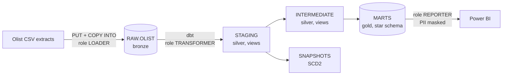
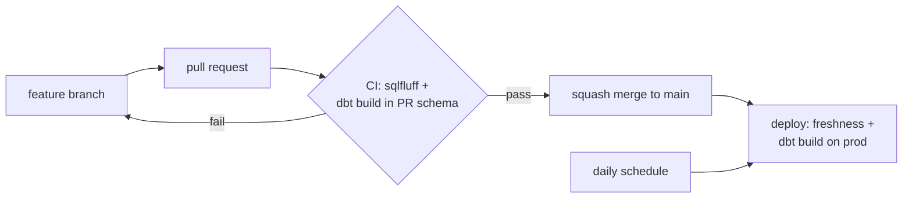

# Olist Analytics: net revenue, end to end

An analytics engineering project on the public [Olist](https://www.kaggle.com/datasets/olistbr/brazilian-ecommerce)
Brazilian e-commerce dataset (99k orders, 2016 to 2018).

**Business question:** how much net revenue does the marketplace make, where does it
come from, and what do late deliveries cost in customer satisfaction?

**One metric:** `net_revenue` = price of the items in orders that became a sale
(not canceled, not unavailable), freight excluded. Defined once in dbt, stored as
a column, reported the same everywhere.

| | |
|---|---|
| Warehouse | Snowflake (key-pair auth, RBAC, dynamic data masking) |
| Transformation | dbt Core 1.12 + dbt_utils |
| BI | Power BI, connected to the marts with a read-only role |
| Orchestration / CI/CD | GitHub Actions |
| Code quality | sqlfluff in CI, pre-commit hooks, dbt tests, unit tests, model contract |

## Architecture



Details, star-schema ERD, environments and the access model: [docs/architecture.md](docs/architecture.md).

## Repository map

```
ingestion/            split_batches.py (two extracts from the static dump), load_raw.py (PUT + COPY INTO)
infra/                Snowflake setup as code: warehouses, databases, roles, grants
models/
  staging/olist/      7 views, 1:1 with source tables: cast, rename, deduplicate, hash PII
  intermediate/       4 views that bring items, payments, reviews and delivery rules to order grain
  marts/core/         fct_order_items (incremental), fct_orders, dim_customers, dim_products, dim_sellers, dim_date
snapshots/            snap_orders: SCD2 history of order status
macros/
  governance/         hash_pii, masking policies, grants for the BI role
  utils/              generate_schema_name, deduplicate_latest, is_revenue_order, CI housekeeping
scripts/              dev.ps1: start a local session (venv + environment check)
tests/                singular tests (revenue reconciliation, payment mismatch monitor) + custom generic test
analyses/             the headline metric in plain SQL
.github/workflows/    ci.yml (pull requests), deploy.yml (merge to main, daily schedule)
powerbi/              the report (PBIP format, text files, versioned like code)
```

## Where each topic lives

| Topic | Evidence |
|---|---|
| Layered modelling (medallion + Kimball) | `models/`, [docs/architecture.md](docs/architecture.md) |
| Incremental model | [models/marts/core/fct_order_items.sql](models/marts/core/fct_order_items.sql) |
| Deduplication | [macros/utils/deduplicate_latest.sql](macros/utils/deduplicate_latest.sql), used by every staging model |
| Macros | `macros/` (8 macro files) |
| Snapshot (SCD2) | [snapshots/snap_orders.yml](snapshots/snap_orders.yml) |
| Data tests | `_*.yml` files next to the models, `tests/` |
| Unit tests | [models/intermediate/_int__models.yml](models/intermediate/_int__models.yml) |
| Model contract | `fct_order_items` in [models/marts/core/_core__models.yml](models/marts/core/_core__models.yml) |
| Source freshness | [models/staging/olist/_olist__sources.yml](models/staging/olist/_olist__sources.yml) |
| Hashing of identifiers | [macros/governance/hash_pii.sql](macros/governance/hash_pii.sql) |
| Dynamic masking | [macros/governance/masking_policies.sql](macros/governance/masking_policies.sql), `dim_customers` |
| Access control (RBAC) | [infra/snowflake/01_account_setup.sql](infra/snowflake/01_account_setup.sql), `grants` in `dbt_project.yml` |
| CI/CD | [.github/workflows/](.github/workflows/) |

## Run it

Prerequisites: Python 3.11, a Snowflake account, an RSA key pair registered on your Snowflake user.

```bash
python -m venv .venv
.venv/Scripts/activate            # Windows.  macOS/Linux: source .venv/bin/activate
pip install -r requirements.txt
dbt deps
pre-commit install
```

On Windows, `.\scripts\dev.ps1` starts a session afterwards: it activates the
environment and checks that the variables below are set.

Connection settings come from environment variables (nothing secret is in the repo):

| Variable | Meaning |
|---|---|
| `SNOWFLAKE_ACCOUNT` | account identifier, `<org>-<account>` |
| `SNOWFLAKE_USER` | login name |
| `SNOWFLAKE_PRIVATE_KEY_PATH` | path to the private key (`.p8`) |
| `OLIST_PII_SALT` | salt for hashing identifiers (required for prod, optional in dev and ci) |

```bash
python infra/apply_setup.py                                  # once: warehouses, databases, roles
python ingestion/split_batches.py --source <folder with the Olist CSVs>
python ingestion/load_raw.py --batch 1                       # initial load into RAW
dbt build                                                    # seed, snapshot, models, tests (dev target)
python ingestion/load_raw.py --batch 2                       # a later extract: new and changed orders
dbt build                                                    # incremental: merges only what changed
```

## Environments and deployment

| Target | Database | Schemas | Trigger |
|---|---|---|---|
| `dev` | `ANALYTICS_DEV` | `DBT_<NAME>_<LAYER>` | developer runs `dbt build` |
| `ci` | `ANALYTICS_CI` | `PR_<number>_<LAYER>` | every pull request; dropped after the run |
| `prod` | `ANALYTICS_PROD` | `<LAYER>` | merge to `main`, daily schedule, manual |

Branching is trunk-based: short-lived `feature/*` branches, pull request into `main`,
CI builds and tests the change in isolation, squash merge. `main` is always what
runs in production.



## Data quality

`dbt build` runs models and tests in dependency order, so a failing test stops
everything downstream of it from being rebuilt on bad data.

- **Generic tests** on every key: `unique`, `not_null`, `relationships`, `accepted_values`, ranges.
- **Singular tests**: the item fact must reconcile with staging to the cent (catches join fan-out);
  payment mismatches are monitored with a warning threshold.
- **Unit tests** for business rules (what counts as a late delivery).
- **Contract** on the BI-facing fact: column names and types cannot change by accident.
- **Source freshness**: warns when no new extract has landed in 24 hours.

## Data protection

| Data | Treatment | Where |
|---|---|---|
| Customer identifier | salted SHA-256 (pseudonymised) | staging |
| Postcode prefix, city | dynamic masking policy, visible to `PII_READER` only | `dim_customers` |
| Review free text | never leaves staging; marts keep a yes/no flag | intermediate |
| Raw and staging data | not readable by the BI role | Snowflake RBAC |

## Replaying the two-batch demo

```bash
python ingestion/load_raw.py --batch 1 --reset               # RAW back to the first extract
dbt run-operation drop_snapshots --args '{confirm: true}'    # snapshots are not rebuilt by --full-refresh
dbt build --full-refresh
```
