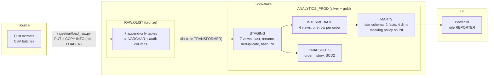
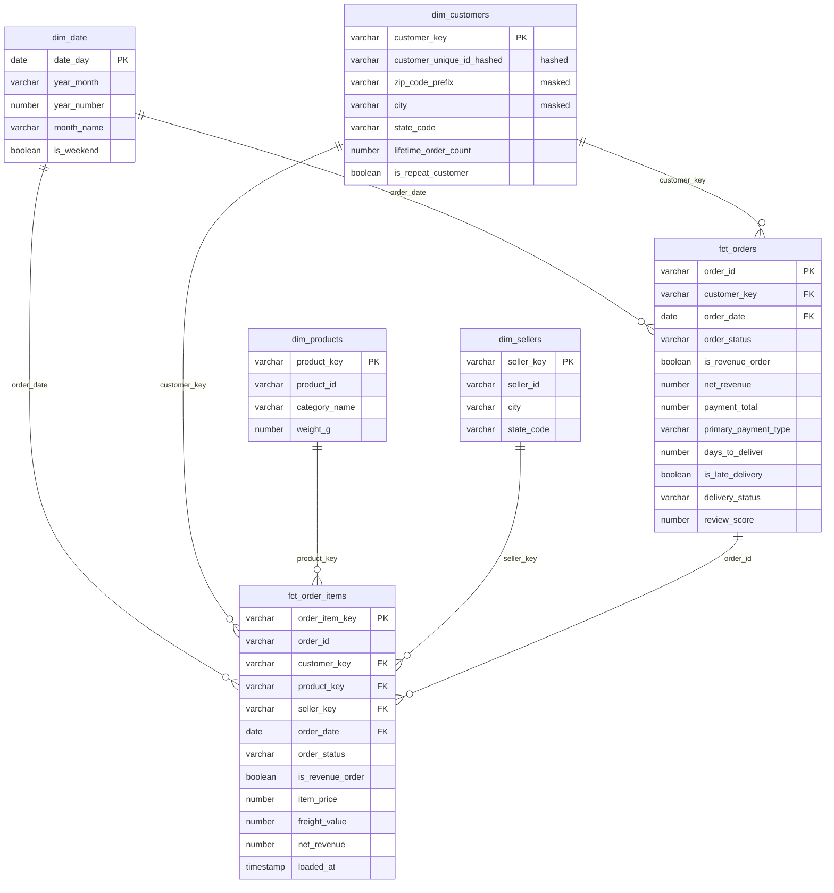
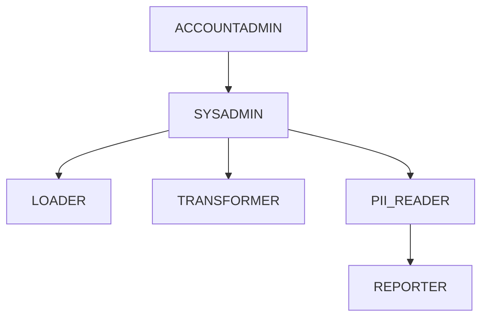

# Architecture

## 1. End-to-end flow

| Layer | Medallion | Where | Materialisation | Rule |
|---|---|---|---|---|
| Raw | Bronze | `RAW.OLIST` | tables, append-only | Never modified. Every column `VARCHAR`. |
| Staging | Silver | `ANALYTICS_*.STAGING` | views | One model per source table. Only place that reads `source()`. |
| Intermediate | Silver | `ANALYTICS_*.INTERMEDIATE` | views | Change grain, apply business rules. Not for BI. |
| Marts | Gold | `ANALYTICS_*.MARTS` | tables (item fact: incremental) | Kimball star schema. Only layer BI can read. |

## 2. Star schema (gold layer)

Two facts at two grains, sharing conformed dimensions:

- `fct_order_items`: one row per **item**. Answers "what was sold" (product, seller, category).
- `fct_orders`: one row per **order**. Answers "how did the order go" (payment, delivery, review).

Payments and reviews exist per order, not per item, so they cannot sit on the
item fact without being repeated on every item row and double-counted.

## 3. Environments

| Target | Database | Schemas | Who writes | Trigger |
|---|---|---|---|---|
| `dev` | `ANALYTICS_DEV` | `DBT_LAZAROS_<LAYER>` | developer | manual `dbt build` |
| `ci` | `ANALYTICS_CI` | `PR_<number>_<LAYER>` | GitHub Actions | every pull request, dropped afterwards |
| `prod` | `ANALYTICS_PROD` | `<LAYER>` | GitHub Actions | merge to `main`, daily schedule |

All three read the same `RAW` database. The schema naming is one macro:
`macros/utils/generate_schema_name.sql`.

## 4. Access control

| Role | Warehouse | Can do | Cannot do |
|---|---|---|---|
| `LOADER` | `LOADING_WH` | write `RAW.OLIST` | read analytics |
| `TRANSFORMER` | `TRANSFORMING_WH` | read `RAW`, own `ANALYTICS_*` | — |
| `REPORTER` | `REPORTING_WH` | read `ANALYTICS_PROD.MARTS`, PII masked | read raw, staging, intermediate |
| `PII_READER` | `REPORTING_WH` | same as `REPORTER`, PII unmasked | — |

Three layers of protection for personal data:

1. **Hashing** (`macros/governance/hash_pii.sql`): the person identifier is replaced by a salted SHA-256 in staging.
2. **Dynamic masking** (`macros/governance/masking_policies.sql`): postcode prefix and city in `dim_customers` are shown only to `PII_READER`.
3. **Minimisation + RBAC**: free-text review comments stay in staging; `REPORTER` has no access to that schema.
